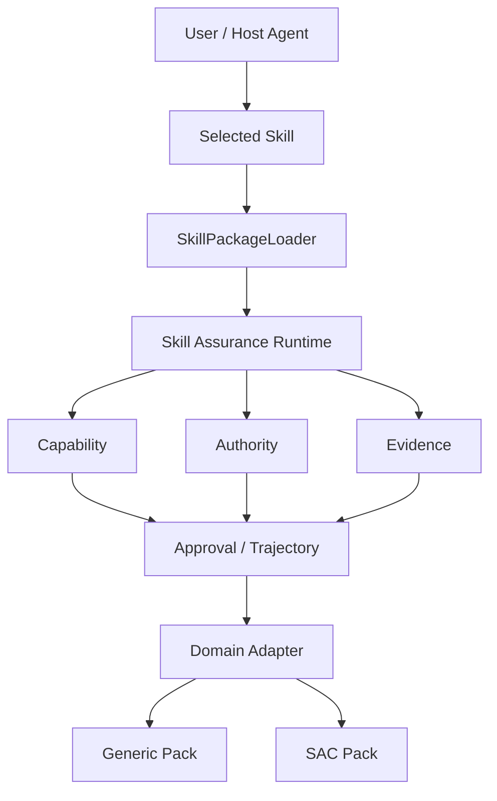

# Agent Skill Assurance Runtime

## V4 公开精修版（与 V1 并存）

最新 `4.0.0.dev5` 公开展示工程位于 [`v4/`](v4/README.md)。本仓库根目录的 V1 包、源码、测试和历史保持原有入口；V4 使用独立的 `agent-action-governance` 包及 `agent_governance` 命名空间，**不是 V1 的直接兼容替换**。

2026-10-12展示修订补充SAC集成复盘及自进化说明，将公开声明用例改为中性fixture命名；冻结源码、Skill、Prompt、Registry和正式门槛保持不变。

```bash
cd v4
python -m venv .venv
# Windows: .venv\Scripts\Activate.ps1
# macOS/Linux: source .venv/bin/activate
python -m pip install -e ".[dev]" build
python -m agent_governance_portfolio verify
python -m pytest -q
```

请分别使用虚拟环境运行 V1 与 V4。V4 保留冻结安全核心、Skill 和 Registry，不重跑历史 Benchmark112，不包含企业完整 SAC 系统或私有证据。[迁移与公开授权记录](V4_PUBLIC_IMPORT.md)说明版本边界及原 ZIP 审核说明的时点差异。V4 为开发展示版本，不是正式 RC1。

> A reusable governance and assurance runtime for Agent Skills, with a generic pack and a real-world SAC energy-dispatch adapter.

面向 Agent Skills 的可复用可信治理运行时，通过 Capability、Authority、Evidence、Approval 与 Trajectory 约束复杂领域 Skill 的安全执行。

## Why this project

Agent Skills package procedural knowledge: **how to package procedural knowledge**. This project adds the assurance questions that a package alone cannot answer: who can execute, what capability may be used, which source has authority, what evidence supports a claim, what must happen before execution, and whether human approval is still valid.

It is not another MCP firewall and does not replace Agent Skills, OWASP ACS, OPA, or a Host Agent Router. It is the skill-level assurance layer between a selected skill and its domain adapter.

## Core contracts

| Contract | Purpose |
| --- | --- |
| Capability Contract | Limits the action surface permitted to a skill and principal. |
| Domain Authority | Resolves conflicts among runtime, validator, policy, evidence, and generated facts. |
| Evidence Support | Promotes raw retrieval to trusted evidence only when explicit support exists. |
| Approval Binding | Binds approval to identity, tenant, agent, subject version, action, arguments, expiry, and single use. |
| Trajectory Assurance | Requires mandatory milestones before sensitive actions. |
| Domain Adapter | Connects a host domain without duplicating the runtime. |



## Generic Skill Pack

`skill_packs/generic_skill/` demonstrates framework portability:

- `change-request-risk-gate`
- `change-request-review`

These packs use the shared runtime, typed governance, approval binding, and Generic Change Request adapter.

## SAC Energy Dispatch Skill Pack

`skill_packs/sac_skill/` contains the specialist skills:

- `dispatch-plan-risk-gate`
- `dispatch-plan-review`

The SAC pack is a sanitized reference implementation derived from a real scheduling-agent workflow. It retains the public design for Candidate Review, Validator, Risk Gate, Plan Delta, Authority, Evidence, and HITL/Approval. It includes no private SAC repository code, real user identifiers, databases, internal URLs, customer data, local paths, or corpus content.

Both packs share one runtime in `src/skill_assurance/`.

## Evaluation

| Evaluation | Result |
| --- | --- |
| Security Gold | 52/52 |
| Trigger Gold | 80 |
| Offline Trigger Precision / Recall / F1 | 100% / 100% / 100% |
| SAC Targeted Regression | 33 passed |
| SAC Real HTTP E2E | 20/20 |
| Unsupported Citation | 0 |

Offline Trigger metrics are measured on the frozen offline Gold set. Host-selector runtime evaluation is not claimed.

## Quick start

```bash
git clone <repo>
cd agent-skill-assurance

pip install -e .
python examples/generic_demo.py
python examples/sac_demo.py
pytest -q
python evals/security/run_security_eval.py
python evals/trigger/run_trigger_eval.py
```

## Capability status

| Capability | Status |
| --- | --- |
| RunContext isolation, approval, trajectory, authority, evidence filtering | IMPLEMENTED |
| Plain-Python runtime and sanitized SAC adapter | IMPLEMENTED |
| LangGraph adapter | EXTENSION POINT |
| ACS backend adapter | EXPERIMENTAL EXTENSION POINT |
| Historical policy replay | EXPERIMENTAL / ROADMAP |

Shadow mode calculates and traces a would-decision without blocking the host action. Generic replay is not release-certified because trace-only replay lacks an immutable policy and domain snapshot.

## Public hygiene

The public package ships no credentials, production endpoints, real users, customer data, private corpus, cache, bytecode, or environment files. Public V1.0 readiness is separate from the private SAC Agent Final Freeze.
